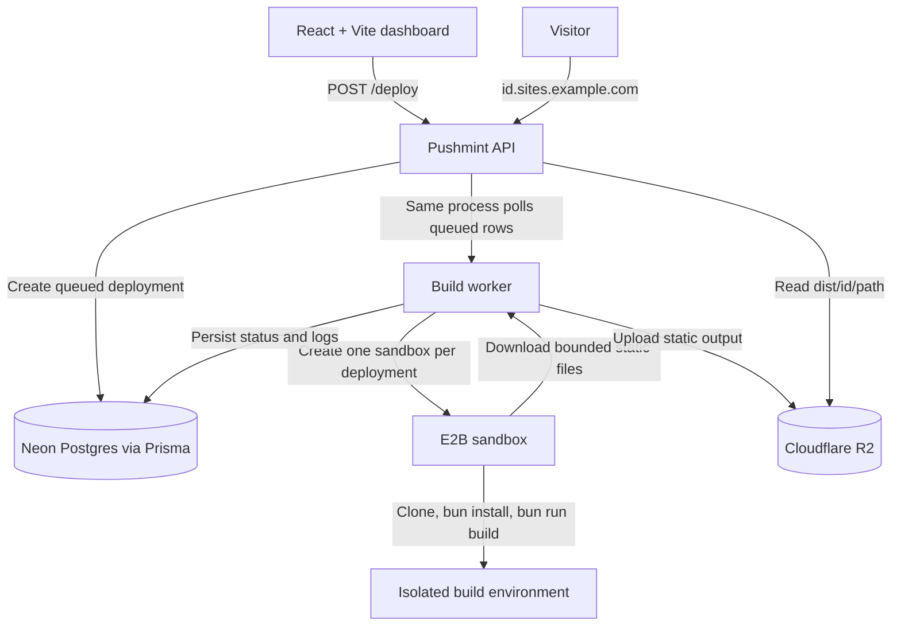

# Pushmint

> Paste a repo. Mint a live site.

Pushmint is a static-site deployment platform. Submit a public GitHub repository, choose a Bun build script and static output directory, then get a unique preview URL with saved status and build logs.

Pushmint targets static output. Server-side rendering, runtime API routes, and long-running application servers are outside its scope.

## Architecture



The API, worker loop, and static request handler are separate modules that run in **one backend service**. Postgres stores deployment rows, queued jobs, and up to 500 recent log lines per deployment. Redis is not required. Each build runs in a disposable E2B sandbox; the backend downloads only bounded static output, uploads it to R2, and stops the sandbox.

## Supported build targets

- **Vite / compatible static apps:** defaults to `bun run build` and `dist/`.
- **Next.js static export:** defaults to `bun run build` and `out/`. The repository must configure `output: "export"` in `next.config.*` and use features supported by static export.
- The deploy form lets you choose a display name, package script, and output directory. The dashboard filters deployments by display name; this is attribution, not authentication.

Bun installs dependencies from `bun.lock` or `bun.lockb` when present, and uses frozen-lockfile mode. Without a Bun lockfile, it resolves dependencies from `package.json` with `bun install`. The worker verifies that output stays inside the checked-out project and contains `index.html`, then enforces file-count and size limits while retrieving files from E2B. Unknown extensionless paths fall back to that index file for client-side routing.

## Cost-conscious deployment

- **Frontend:** deploy `frontend/` as a static site on Vercel or Cloudflare Pages, using Bun commands.
- **Backend:** deploy the repository's `Dockerfile` as one Render web service. The image uses Bun and runs the API, build loop, and static request handler together. No separate worker, cron, or Redis service is needed.
- **Database:** Neon Postgres, accessed through Prisma. The service applies the checked-in migration at startup.
- **Static artifacts:** Cloudflare R2.

Render's free web services can sleep when idle and have limited CPU and memory. Builds may wait for the service to wake. This setup is for a hobby/resume demo, not production hosting. Keep spending limits enabled and monitor provider usage.

## Local setup

Requirements: Bun 1.4.2 or compatible, and a reachable Postgres database (Neon works). Create a Cloudflare Turnstile widget and put its site key in `frontend/.env` as `VITE_TURNSTILE_SITE_KEY`. Put the matching secret in `uploadService/.env` as `TURNSTILE_SECRET_KEY`. Also set `E2B_API_KEY` and a random `RATE_LIMIT_SECRET` of at least 32 characters in `uploadService/.env`. E2B and Turnstile secrets stay on the backend and are never sent to the browser or build sandbox.

Copy the backend template and set your Postgres, R2, and allowed repository values:

```bash
cp uploadService/.env.example uploadService/.env
```

Install and build the backend packages from the repository root:

```bash
cd deployService && bun install --frozen-lockfile && bun run build
cd ../reqHandler && bun install --frozen-lockfile && bun run build
cd ../uploadService && bun install --frozen-lockfile && bun run build && bun run start
```

Startup applies the Prisma migration. The API and static router listen on port `3000`; local preview URLs use `http://<deployment-id>.localhost:3000`.

Copy the frontend template:

```bash
cp frontend/.env.example frontend/.env
```

Then run:

```bash
cd frontend && bun install --frozen-lockfile && bun run dev
```

Open the Vite URL, usually `http://localhost:5173`. On Render, the checked-in `render.yaml` configures one Docker web service. Set its Neon, R2, E2B, Turnstile secret, rate-limit secret, frontend origin, and site-domain environment variables. Set `VITE_TURNSTILE_SITE_KEY` in the frontend hosting provider before building the frontend. In production, set `SITE_DOMAIN` to the preview hostname suffix (for example, `sites.example.com`), `PUBLIC_SITE_PROTOCOL=https`, and point the wildcard preview hostname through Cloudflare to the backend service.

## Checks

```bash
cd uploadService && bun run build && bun test src/test
cd ../deployService && bun run build && bun test src/test
cd ../reqHandler && bun run build && bun test src/test
cd ../frontend && bun run build
```

## Scope and safety

- Any syntactically valid public HTTPS GitHub repository can be submitted. Builds clone anonymously, so private repositories are not supported.
- Repository install/build scripts execute code inside a separate E2B microVM for each deployment. The sandbox receives no backend, database, or R2 credentials; only the requested static output is copied back.
- Every deployment request must pass Cloudflare Turnstile. The API applies limits of 3 deployments per hour and 10 per day to both the client IP and the normalized display name, with a maximum of 20 queued jobs. Display names are not verified accounts; keep IP limits enabled and do not treat names as ownership proof. The worker processes builds one at a time. Set `DEPLOYMENTS_ENABLED=false` to pause new deployments.
- Sandboxes need outbound internet access to clone repositories and download dependencies. Set E2B spending limits and monitor sandbox use; the per-IP and queue limits reduce abuse but cannot guarantee a fixed E2B bill.
- Sandbox lifetime is bounded by `BUILD_TIMEOUT_MS` and the E2B sandbox timeout; output is capped at 2,000 files, 25 MB per file, and 100 MB total.
- Each deployment gets an immutable URL. Project aliases, automatic Git webhooks, custom build containers, and server-side app runtimes are not included.
